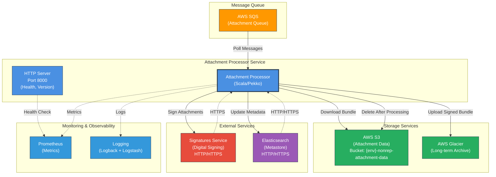

# Microservice Architecture - Attachment Processor

## System Context

The **Attachment Processor** is a critical component within the Non-Repudiation Store (NRS) ecosystem. It serves as a bridge between message queuing infrastructure and long-term archival systems, ensuring attachments are securely signed, archived, and indexed for retrieval.

## Architecture Diagram



## Service Dependencies

### Inbound Connections

#### AWS SQS (Message Queue)
- **Purpose:** Source of attachment processing jobs
- **Protocol:** AWS SDK v2.45+
- **Queue Name:** Determined by `ATTACHMENT_SQS` environment variable
- **Polling Strategy:** 
  - Long polling with configurable wait time (default: 20s)
  - Throttling: `messagesPerSecond` configuration
  - Auto-restart with exponential backoff on failures
- **Message Format:** JSON containing attachment metadata and S3 reference
- **Local Development:** LocalStack mock SQS available at `http://sqs.eu-west-2.localhost.localstack.cloud:4566`

**Reliability Features:**
- Exponential backoff retry (1s min, 3s max)
- Maximum 20 restarts within 5-minute window
- Graceful degradation on SQS unavailability

### Outbound Connections

#### AWS S3 (Object Storage)
- **Purpose:** 
  - **Input:** Download original attachment bundles
  - **Output:** Delete processed bundles after archival
- **Protocol:** AWS SDK v2.45+
- **Bucket:** `{env}-nonrep-attachment-data`
- **Configuration:** Via Pekko S3 Connector settings
- **Operations:**
  - `GetObject`: Retrieve original bundles (Download Bundle stage)
  - `DeleteObject`: Remove bundles after successful processing (Delete Bundle stage)
- **Performance:** Streaming for large files, optimized for high throughput

**Features:**
- Automatic AWS credential resolution
- Regional endpoints (eu-west-2)
- Connection pooling and timeout management

#### AWS Glacier (Archive Storage)
- **Purpose:** Long-term immutable storage of signed attachments
- **Protocol:** AWS SDK v2.45+
- **Endpoint:** Configurable via `glacier-url` parameter
- **Operations:** Archive (upload) only
- **Retention:** Permanent archival for regulatory compliance
- **Response:** Returns Archive ID for retrieval tracking

**Key Characteristics:**
- Write-once, immutable storage model
- Retrieval time: Hours to days (retrieval handled by separate service)
- Cost-effective for long-term retention (10+ years)
- Regional availability (eu-west-2)

#### Signatures Microservice (Digital Signing)
- **Purpose:** Apply cryptographic signatures to attachments
- **Protocol:** HTTP/HTTPS
- **Endpoint:** Configured via `attachment-processor.signatures.service-url`
- **Host/Port:** Dynamically resolved from configuration URI
- **Request Format:** Attachment content for signing
- **Response:** Signed attachment content
- **Concurrency:** Buffered operations (default: 10 concurrent requests)

**Service Details:**
- Implements XML Digital Signature (XAdES) standards
- Maintains audit trail of all signing operations
- Supports configurable signing profiles
- Handles certificate rotation and key management

**Configuration Example:**
```
attachment-processor.signatures:
  service-url: "https://signatures-service.example.com:8080"
  signing-profile: "default"
```

#### Elasticsearch (Metastore)
- **Purpose:** Index and store attachment metadata for searchability and retrieval
- **Protocol:** HTTP/HTTPS
- **Endpoint:** Configured via `ELASTICSEARCH` environment variable
- **Host/Port:** Dynamically resolved from configuration URI
- **Default (Local):** `http://elasticsearch.nrs`
- **Operations:**
  - Index documents with attachment metadata
  - Update processing status
  - Store archive IDs and timestamps
- **Concurrency:** Buffered operations (default: 10 concurrent requests)
- **Refresh Policy:** Configurable for index refresh intervals

**Service Details:**
- Elasticsearch 7.x/8.x compatibility
- Implements document-based architecture
- Full-text search capability on metadata
- Real-time index updates
- Supports custom analyzers for attachment attributes

**Configuration Example:**
```
attachment-processor:
  elasticsearch: "https://es-prod.example.com:9200"
  
metastore:
  refresh_policy: "wait_for"  # or "immediate"
```

### Health & Monitoring

#### Prometheus Metrics
- **Purpose:** Collect and expose performance metrics
- **Format:** Prometheus text format (port 8000)
- **Endpoint:** `/metrics` (implicit via Pekko HTTP Metrics library)
- **Metrics Collected:**
  - `attachment_processing_duration_seconds`: Time per attachment (by size bucket)
  - `attachment_processing_errors_total`: Error counts by type
  - JVM metrics (heap, GC, threads)
  - Pekko actor metrics

#### Logging Infrastructure
- **Framework:** Logback + SLF4J
- **Format:** JSON (Logstash encoder)
- **Outputs:** 
  - Console (local development)
  - File-based (production)
  - Log aggregation (ELK stack)
- **Log Levels:** 
  - INFO: Normal processing events
  - ERROR: Failures and exceptions
  - DEBUG: Detailed diagnostic information

**Key Log Streams:**
- `getMessages`: SQS polling activity
- `parseMessage`: Message deserialization
- `downloadBundle`: S3 retrieval
- `unpackBundle`: ZIP extraction
- `signAttachment`: Signature generation
- `repackBundle`: Bundle creation
- `archiveBundle`: Glacier upload
- `updateMetastore`: Elasticsearch indexing
- `deleteMessage`: SQS acknowledgment
- `deleteBundle`: S3 cleanup

## Deployment Architecture

### Docker Container
- **Base Image:** Ubuntu 20.04 + Amazon Corretto Java 21 JDK
- **Artifact:** `attachment-processor.jar` (Scala 3.7.4, Fat JAR)
- **Registry:** AWS ECR (`979211549557.dkr.ecr.eu-west-2.amazonaws.com/attachment-processor`)
- **Versioning:** Git-based semantic versioning
- **Timezone:** Europe/London

### CI/CD Pipeline (AWS CodeBuild)
- **Runtime:** Java 21 (Corretto)
- **Build Tool:** SBT 1.10.11
- **Compilation:** Scala 3.7.4 → JVM bytecode
- **Assembly:** Uber JAR with merged dependencies
- **Tagging:** Automatic version tagging on main branch
- **Publishing:** Push to AWS ECR (tagged + latest)

### Environment Configuration
| Environment | Bucket Naming | ElasticSearch | Glacier | Purpose |
|-------------|---------------|---------------|---------|---------|
| local | local-nonrep-attachment-data | localhost:9200 | LocalStack | Development |
| dev | dev-nonrep-attachment-data | dev-es.nrs | AWS Glacier | Dev testing |
| qa | qa-nonrep-attachment-data | qa-es.nrs | AWS Glacier | QA validation |
| staging | staging-nonrep-attachment-data | staging-es.nrs | AWS Glacier | Pre-production |
| production | production-nonrep-attachment-data | prod-es.nrs | AWS Glacier | Live service |

## Service Communication Patterns

### Request Flow for Single Attachment

```
1. SQS → AP: Message poll (pull)
2. AP → S3: Download bundle (GET)
3. AP: Extract ZIP, decompress
4. AP → Signatures: Sign attachments (POST)
5. AP: Repack as signed ZIP
6. AP → Glacier: Archive bundle (PUT)
7. AP → Elasticsearch: Index metadata (POST)
8. AP → SQS: Delete message (HTTP)
9. AP → S3: Delete bundle (DELETE)
```

**Success Path:** All steps complete → Metrics recorded
**Failure Path:** Error at any step → Application sink handles → Logs error → Message remains in queue (retry)

### Concurrency & Buffering

The processor uses Pekko Streams with configurable buffer sizes to handle concurrent operations:

- **SQS Polling:** Single threaded (sequential message consumption)
- **Signatures:** Buffered (default 10 concurrent signing operations)
- **Elasticsearch:** Buffered (default 10 concurrent index operations)
- **S3/Glacier:** Sequential within pipeline (pipelined with other stages)

## Network & Security Considerations

### Certificate Management
- Production certificates loaded from AWS Secrets Manager during build
- Support for TLS 1.2+ for all HTTPS connections
- Certificate rotation via build-time update

### AWS Credentials
- Resolved via AWS SDK default credential provider chain
- Support for IAM roles (Kubernetes/EC2)
- STS temporary credentials with auto-refresh

### Timeout & Connection Settings
- SQS: Configurable wait time (default 20s)
- S3/Glacier: HTTP connection pooling
- Elasticsearch: Health checks via periodic requests
- Signatures Service: Configurable timeout (from service config)

## Scaling & Performance

### Throughput Optimization
- **Message Throttling:** `messagesPerSecond` limits consumption rate
- **Buffering:** Configurable buffer sizes for signature and metadata operations
- **Pipelining:** Stages execute in parallel where possible
- **Resource Usage:** JVM memory management with Corretto optimizations

### High Availability
- **Restart Resilience:** Auto-recovery from transient SQS failures
- **Graceful Shutdown:** Coordinated shutdown via Pekko CoordinatedShutdown
- **Health Endpoints:** Ping and version for orchestration health checks
- **Stateless Design:** No local state; can be horizontally scaled

## Integration Checklist

When integrating the Attachment Processor into your environment:

- [ ] Configure SQS queue URL in `ATTACHMENT_SQS`
- [ ] Set up S3 bucket with naming pattern `{env}-nonrep-attachment-data`
- [ ] Provide Elasticsearch endpoint via `ELASTICSEARCH`
- [ ] Configure Signatures microservice URL in `application.conf`
- [ ] Set `ENV` variable to match your environment
- [ ] Ensure IAM roles grant S3, SQS, and Glacier access
- [ ] Configure certificate paths for TLS communication
- [ ] Set up Prometheus scraping for `/metrics` endpoint
- [ ] Configure log aggregation for ELK stack
- [ ] Test health endpoints: `/attachment-processor/ping`, `/attachment-processor/version`

## Related Services

- **Non-Repudiation Store (NRS):** Parent microservice ecosystem
- **Signatures Service:** Cryptographic signing provider
- **Metastore Query Service:** Retrieves archived attachments via Elasticsearch
- **Digital Service Platform:** HMRC PaaS hosting environment
