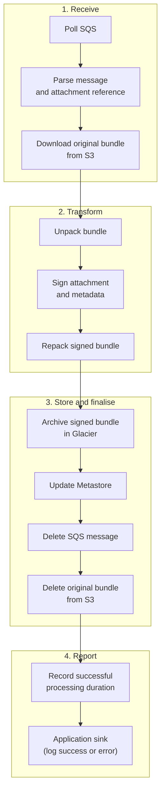
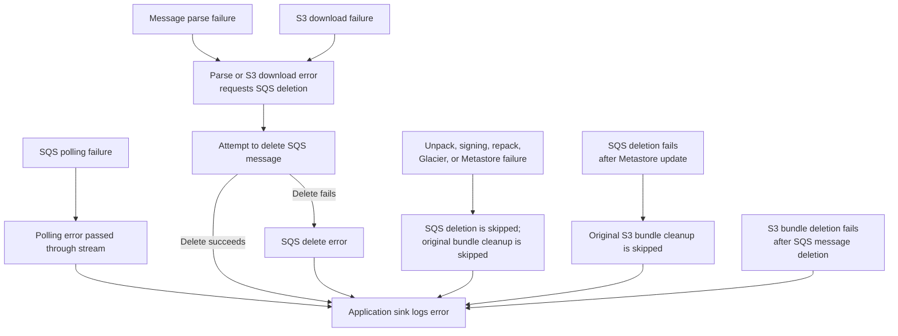

# Attachment Processor Flow

## Overview

The **Attachment Processor** is a streaming service that consumes messages from AWS SQS, processes attachments through a series of transformation steps, and stores them securely in AWS Glacier while updating metadata in Elasticsearch.

The processor implements a robust pipeline using Apache Pekko Streams that handles attachment processing with error recovery, logging, and metrics collection.

## Processing Pipeline

The diagram shows the successful path grouped into four phases. Error outcomes and message acknowledgement behavior are summarized below.



## Processing Stages

### 1. **Get Messages** (SQS Source)
- Continuously polls the SQS queue for new messages
- Implements throttling to control message consumption rate (configurable `messagesPerSecond`)
- Uses `RestartSource` with backoff strategy for automatic recovery on SQS failures
- Logs all activity at INFO level

**Key Features:**
- Automatic retry with exponential backoff (1s min, 3s max)
- Message throttling to prevent overload
- Comprehensive logging and error tracking

### 2. **Parse Message** (Message Deserialization)
- Extracts attachment metadata from the SQS message
- Converts raw SQS message into `AttachmentInfo` domain object
- Validates message structure and required fields
- Records processing start timestamp for metrics

### 3. **Download Bundle** (S3 Retrieval)
- Fetches the attachment bundle from the configured S3 bucket
- Bucket name: `{env}-nonrep-attachment-data`
- Streams large files efficiently
- Handles S3 failures and connectivity issues

### 4. **Unpack Bundle** (ZIP Extraction)
- Extracts the ZIP file contents into memory
- Preserves file structure and metadata
- Separates individual attachments for processing

### 5. **Sign Attachment** (Digital Signature)
- Applies cryptographic signatures to each attachment
- Integrates with the Signatures microservice (HTTP)
- Uses configured signing profile for consistent signatures
- Maintains a configurable buffer for concurrent signing operations

**Service Integration:**
- **Endpoint:** Signatures microservice (HTTP/HTTPS)
- **Buffer Size:** Configurable `signServiceBufferSize`

### 6. **Repack Bundle** (ZIP Creation)
- Creates a new ZIP file containing the signed attachments
- Maintains original file structure and metadata
- Optimizes compression settings

### 7. **Archive Bundle** (Glacier Storage)
- Stores the signed, repacked bundle in AWS Glacier for long-term retention
- Provides immutable, tamper-proof storage
- Generates archive ID for retrieval tracking
- Integrates with AWS SDK for Java (v2.45+)

### 8. **Update Metastore** (Elasticsearch)
- Updates attachment metadata in Elasticsearch
- Stores processing results, archive IDs, and timestamps
- Makes processed attachments searchable and retrievable
- Maintains audit trail of processing activities

**Service Integration:**
- **Endpoint:** Elasticsearch (HTTP/HTTPS)
- **Host/Port:** Configurable via `ELASTICSEARCH` environment variable
- **Buffer Size:** Configurable `esServiceBufferSize`

### 9. **Delete Message** (SQS Cleanup)
- Removes the processed message from the SQS queue
- Only executed after successful Metastore update
- Prevents reprocessing of completed attachments

### 10. **Delete Bundle** (S3 Cleanup)
- Removes the original bundle from S3 after successful archival
- Reduces storage costs post-processing
- Only executed after successful deletion from SQS

### 11. **Record Metrics** (Prometheus)
- Captures processing duration for each attachment
- Buckets metrics by attachment size
- Tracks success and failure rates
- Exports metrics in Prometheus format

## Error Flows

The following diagram separates failure handling from the successful processing path. Error results continue through the stream as `Left` values; later operations that require successful attachment data are skipped.



### Error outcomes

| Failure point | SQS message outcome | Other consequences |
|---|---|---|
| SQS polling | No message receipt is available to delete. | Error is passed to the sink. |
| Message parsing or S3 download | The error carries the receipt handle and the pipeline attempts to delete the message. | Remaining processing is skipped; deletion failure is reported as an SQS delete error. |
| Unpack, signing, repack, Glacier archive, or Metastore update | The pipeline does not delete the message. | Later stages that need successful attachment data are skipped; the sink logs the error. |
| SQS deletion after Metastore update | Deletion failure is reported; successful deletion is not confirmed. | Original S3 bundle cleanup is skipped. |
| S3 bundle cleanup | The SQS message has already been deleted on this path. | The cleanup error is reported to the sink. |

The sink logs success or errors; it does not implement dead-letter handling. SQS redelivery depends on queue visibility and retention configuration. Processing-duration metrics are recorded only for successful results. If a failure occurs after an external side effect (for example, Glacier archive upload), the diagram does not imply that the side effect is rolled back.

## Configuration

Key configuration parameters (from `application.conf`):

```yaml
attachment-processor:
  system-params:
    maxBufferSize: 10          # Max buffer for stream processing
    maxBatchSize: 10           # Max batch size per request
    closeOnEmptyReceive: true  # Close stream on empty SQS receive
    waitTimeSeconds: 20        # SQS long polling timeout
    messagesPerSecond: 10      # Rate limiting for message consumption
    signServiceBufferSize: 10  # Concurrent signing operations
    esServiceBufferSize: 10    # Concurrent Elasticsearch operations
  
  signatures:
    service-url: https://...   # Signatures microservice URL
    signing-profile: "..."      # Active signing profile
  
  glacier:
    glacier-url: https://...   # AWS Glacier endpoint (optional)
  
  sqs:
    restart_policy:
      minBackoff: 1s
      maxBackoff: 3s
      randomFactor: 0.2
      maxRestarts: 20
      maxRestartsDuration: 5m
  
  metastore:
    refresh_policy: ...        # Elasticsearch refresh policy
```

## Environment Variables

| Variable | Purpose | Example |
|----------|---------|---------|
| `REST_PORT` | HTTP server port | 8000 |
| `ENV` | Environment identifier | local/dev/qa/staging/production |
| `ATTACHMENT_SQS` | SQS queue URL | http://sqs.eu-west-2... |
| `ELASTICSEARCH` | Elasticsearch endpoint | http://elasticsearch.nrs |
| `S3_*` | AWS S3 credentials/config | (from application.conf) |

## Health & Monitoring

### Endpoints

- **Ping:** `GET /attachment-processor/ping` → `pong`
- **Version:** `GET /attachment-processor/version` → `{"version": "..."}`

### Metrics

- Processing duration per attachment (by size bucket)
- Message throughput rate
- Error rates and types
- Elasticsearch and Signatures service latency

## Running the Service

```bash
# Local development
sbt run

# With environment configuration
ENV=dev REST_PORT=8000 ATTACHMENT_SQS=... sbt run

# Docker
docker build -t attachment-processor .
docker run -e ENV=dev -e ATTACHMENT_SQS=... attachment-processor:latest
```

## Testing

```bash
# Unit tests
sbt clean test

# Integration tests
sbt it:test

# Format checking
sbt scalafmtCheckAll it:scalafmtCheckAll
```
